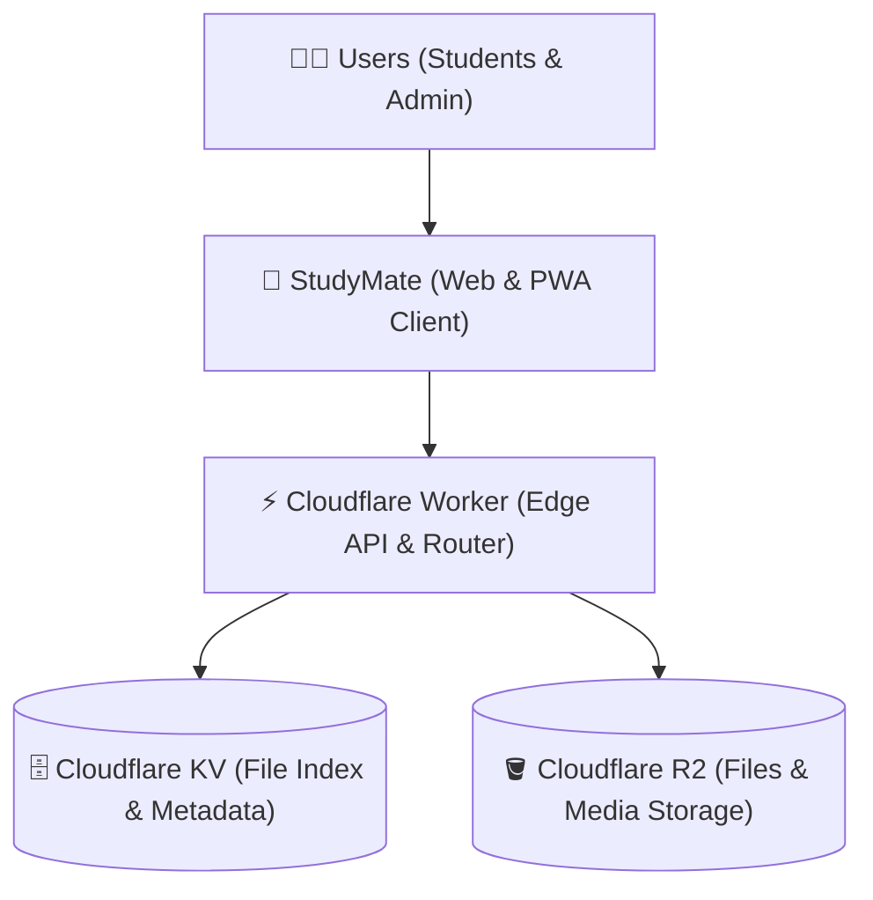

<div align="center">

# 🎓 StudyMate
### Modern Edge-Powered Learning & Resource Hub

[](https://studymate.eeedept.workers.dev)
[](https://workers.cloudflare.com/)
[](https://developers.cloudflare.com/r2/)
[](https://web.dev/progressive-web-apps/)
[](LICENSE)
[](https://github.com/hariharanboss/Study-mate/stargazers)

<p align="center">
  <b>StudyMate</b> is an ultra-fast, edge-native digital study hub and personal learning management system built for students, educators, and lifelong learners. Powered entirely by Cloudflare Workers, Cloudflare KV, and Cloudflare R2 object storage, it delivers zero-latency document browsing, multi-format in-browser previews, and full administrative capabilities with zero server maintenance and zero egress fees.
</p>

</div>

---

## 🌟 Key Highlights

- ⚡ **Zero-Latency Global Edge Runtime** — Operates on Cloudflare's planetary edge network within 50ms of 95% of the world's population.
- 🗄️ **Zero-Egress Object Storage (Cloudflare R2)** — Store high-resolution lecture notes, PDFs, presentations, audio, and videos without bandwidth surcharges.
- 📱 **Google Drive M3 Mobile Experience** — Native mobile ergonomics featuring 2-column touch grids, horizontal breadcrumbs, slide-up bottom sheets, and sticky quick-access pill navigation.
- 👁️ **Multi-Format In-Browser Previews** — Native rendering for:
  - 📄 **PDFs** via embedded PDF.js reader with zoom, thumbstrip, and page jump.
  - 📝 **Word Docs (`.docx`)** rendered dynamically via Mammoth.js.
  - 💻 **Syntax-Highlighted Source Code** (`.py`, `.js`, `.cpp`, `.java`, `.html`, `.css`, `.json`, `.sql`) via Highlight.js.
  - 🎨 **Slide Presentation Mode** with full-screen slide controls.
  - 🎵 **Media Player** for lecture recordings (`.mp4`, `.webm`, `.mp3`, `.wav`) using Plyr.
- 📝 **Windows-Style In-App Notepad** — Integrated rich text, code, and note editor with customizable fonts, formatting controls, and instant publishing.
- 🎨 **Dynamic Glassmorphism UI** — Curated Dark, AMOLED Black, and Clean Light themes with reactive Three.js background particles.
- 🗑️ **Two-Stage Recycle Bin** — Soft-delete safeguard with instant restoration, preventing accidental data loss.
- 🔒 **Role-Based Edge Authentication** — Dual-tier passkey access: lightweight student visitor authentication and an admin control room.
- 📊 **Real-Time Storage & Usage Analytics** — Live tracking of active folders, storage utilization, and study session progress.
- 📶 **Offline PWA Support** — Service worker caching ensures critical materials remain accessible even during network interruptions.

---

## 🏗️ Architecture



---

## 🚀 Quickstart & Local Development

### Prerequisites

- [Node.js](https://nodejs.org/) v18.0.0 or higher
- [npm](https://www.npmjs.com/) v9.0.0 or higher
- [Cloudflare Wrangler CLI](https://developers.cloudflare.com/workers/wrangler/)

### 1. Clone the Repository

```bash
git clone https://github.com/hariharanboss/Study-mate.git
cd Study-mate
```

### 2. Install Dependencies

```bash
npm install
```

### 3. Configure Local Environment

Copy or modify `wrangler.toml` with your desired configuration:

```toml
name = "study-mate"
main = "worker.js"
compatibility_date = "2024-01-01"

[vars]
ENVIRONMENT = "development"
ADMIN_PASSWORD = "admin" # Set your secure admin password
VISITOR_PASSWORD = ""    # Optional visitor passcode

[[kv_namespaces]]
binding = "LMS_KV"
id = "YOUR_KV_NAMESPACE_ID"
preview_id = "YOUR_KV_PREVIEW_ID"

[[r2_buckets]]
binding = "LMS_BUCKET"
bucket_name = "study-mate-storage"
```

### 4. Build Bundles & Start Dev Server

```bash
# Compile index.html and sw.js into inlined edge assets
node build.js

# Launch the local Wrangler development server
npm run dev
```

Visit `http://localhost:8787` in your browser.

---

## ☁️ Production Deployment

Deploying StudyMate to Cloudflare takes less than 3 minutes:

### 1. Log in to Cloudflare

```bash
npx wrangler login
```

### 2. Create the KV Namespace

```bash
npx wrangler kv:namespace create "LMS_KV"
```

Copy the returned `id` and paste it into your `wrangler.toml` under `[[kv_namespaces]]`.

### 3. Create the R2 Storage Bucket

```bash
npx wrangler r2 bucket create study-mate-storage
```

Ensure the bucket name matches the `bucket_name` in `wrangler.toml`.

### 4. Compile and Deploy

```bash
# Build the production bundle
node build.js

# Deploy to Cloudflare Workers edge network
npx wrangler deploy
```

Your learning portal will immediately be live on your custom `*.workers.dev` subdomain!

---

## 📋 API & Edge Endpoints

| Method | Endpoint | Access | Description |
|---|---|---|---|
| `GET` | `/` | Public | Serves the single-page responsive web client |
| `GET` | `/api/fs` | Public | Retrieves the virtual file system tree and hierarchy |
| `POST` | `/api/admin/login` | Public | Verifies admin credentials and issues a secure session token |
| `POST` | `/api/admin/upload` | Admin | Uploads files and registers metadata into KV and R2 |
| `POST` | `/api/admin/folder` | Admin | Creates a new subject or subfolder directory |
| `DELETE` | `/api/admin/item` | Admin | Soft-deletes a file or directory into the Recycle Bin |
| `GET` | `/api/admin/trash` | Admin | Fetches deleted items currently in the Recycle Bin |
| `POST` | `/api/admin/restore` | Admin | Restores a deleted item back to its original folder |
| `DELETE` | `/api/admin/purge` | Admin | Permanently erases an item from the Recycle Bin |
| `GET` | `/api/admin/analytics` | Admin | Summarizes storage quota, total files, and folder count |
| `POST` | `/api/admin/broadcast` | Admin | Publishes a top-bar banner alert or announcement |
| `POST` | `/api/admin/notes` | Admin | Stores or updates sticky note canvas items |

---

## 📁 Project Structure

```text
Study-mate/
├── .github/                   # GitHub action workflows
├── icons/                     # PWA asset icons and splash screens
├── index.html                 # Main single-page application & UI system
├── worker.js                  # Cloudflare Worker edge router & API handlers
├── sw.js                      # Service Worker caching engine
├── virtual-fs.default.js      # Base initial folder & index schema
├── build.js                   # High-performance asset compilation script
├── wrangler.toml              # Cloudflare Worker configuration & bindings
├── package.json               # Node.js project manifest & scripts
├── LICENSE                    # MIT License
└── README.md                  # Project documentation
```

---

## 🎨 Technology Stack

- **Compute & CDN**: [Cloudflare Workers](https://workers.cloudflare.com/) (V8 Serverless Isolates)
- **Database & State**: [Cloudflare KV](https://developers.cloudflare.com/kv/) (Distributed Key-Value Store)
- **Object Storage**: [Cloudflare R2](https://developers.cloudflare.com/r2/) (S3-Compatible Zero-Egress Storage)
- **Frontend Architecture**: Modern Vanilla ES6+, CSS Glassmorphism Engine
- **Visuals & 3D**: [Three.js](https://threejs.org/) Interactive Slides Particles
- **Document Viewing**: [PDF.js](https://mozilla.github.io/pdf.js/), [Mammoth.js](https://github.com/mwilliamson/mammoth.js), [Highlight.js](https://highlightjs.org/)
- **Media Playback**: [Plyr.js](https://plyr.io/)

---

## 🤝 Contributing

Contributions, issues, and feature requests are welcome!

1. Fork the Project (`https://github.com/hariharanboss/Study-mate/fork`)
2. Create your Feature Branch (`git checkout -b feature/AmazingFeature`)
3. Commit your Changes (`git commit -m 'Add some AmazingFeature'`)
4. Push to the Branch (`git push origin feature/AmazingFeature`)
5. Open a Pull Request

---

## 👥 Authors & Acknowledgments

| Avatar | Contributor | Role & Contributions | GitHub Profile |
|:---:|:---:|:---|:---:|
| <a href="https://github.com/hariharanboss"></a> | **Hariharan** | **Lead Architect & Developer**<br/>• Full system architecture & data modeling<br/>• End-to-end source code & UI/UX design<br/>• Cloudflare Workers edge & storage engineering | [@hariharanboss](https://github.com/hariharanboss) |
| <a href="https://github.com/Vanavan-1"></a> | **Vanavan** | **Concept & Ideation**<br/>• Original project concept & core vision<br/>• Early interface mockup & layout ideation | [@Vanavan-1](https://github.com/Vanavan-1) |

---

## 📄 License

Distributed under the **MIT License**. See `LICENSE` for more information.

---

<p align="center">
  Crafted with ❤️ for students and educators worldwide.
</p>
