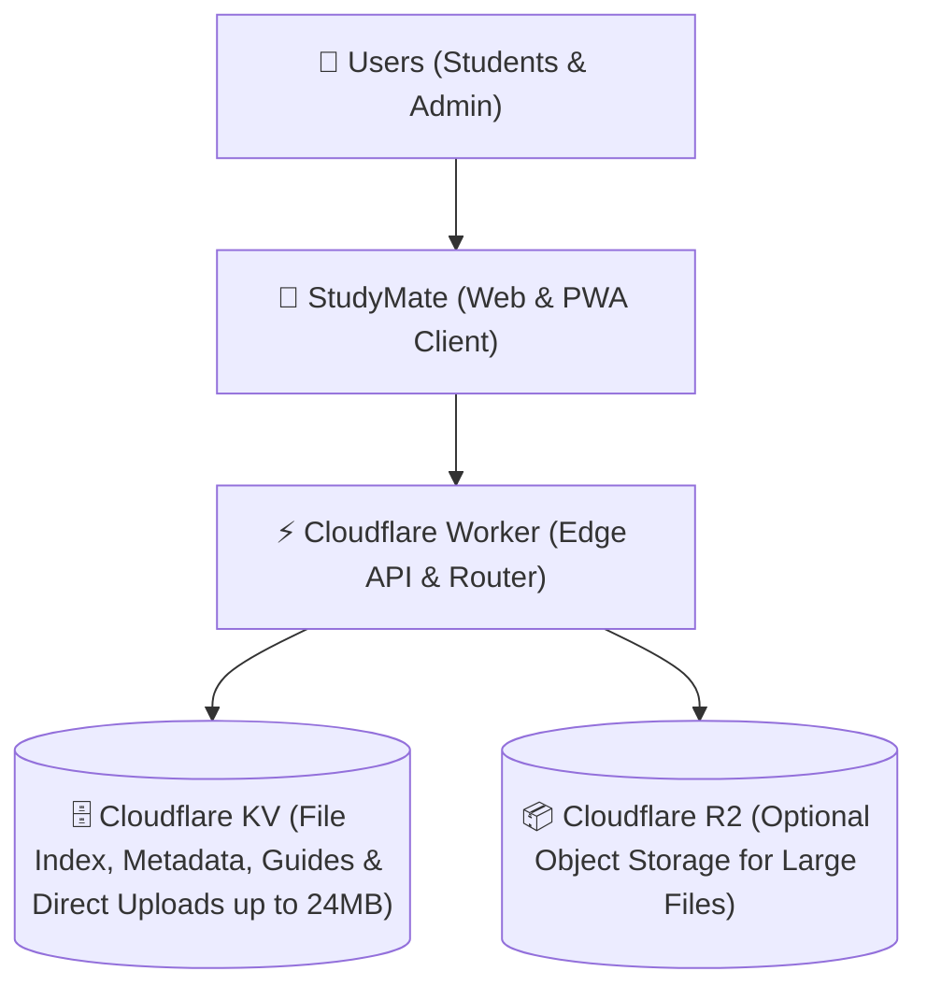

<div align="center">

# 📚 StudyMate
### Modern Edge-Powered Learning & Resource Hub

[](https://studymate.eeedept.workers.dev)
[](https://workers.cloudflare.com/)
[](https://developers.cloudflare.com/r2/)
[](https://web.dev/progressive-web-apps/)
[](LICENSE)
[](https://github.com/hariharanboss/Study-mate/stargazers)

<p align="center">
  <b>StudyMate</b> is an ultra-fast, edge-native digital study hub and personal learning management system built for students, educators, and lifelong learners. Powered entirely by Cloudflare Workers, Cloudflare KV, and Cloudflare R2 object storage, it delivers zero-latency document browsing, multi-format in-browser previews, and full administrative capabilities with zero server maintenance and zero egress fees.
</p>

</div>

---

## ⚡ Key Highlights

- 🚀 **Zero-Latency Global Edge Runtime** — Operates on Cloudflare's planetary edge network within 50ms of 95% of the world's population.
- 🗂️ **Windows 10/11 Explorer Ergonomics (Desktop)** — Native desktop file management: single-click to select and highlight an item, double-click to open folders/files, and native **Cut (`Ctrl + X`)**, **Copy (`Ctrl + C`)**, and **Paste (`Ctrl + V`)** across directories with recursive folder and file moving/cloning.
- 📂 **Universal Folder Moving & Breadcrumbs Drop** — Drag any folder (with all its nested files) and drop directly onto any parent breadcrumb or Back button to move it up the directory hierarchy instantly, or right-click to *Move this folder to...*.
- 📱 **Google Drive & M3 Mobile Experience** — Touch-optimized mobile layout with responsive two-column grid, slide-up bottom sheets, sticky filter pills, and single-tap instant access.
- 🧭 **Liquid Breadcrumb Navigation** — Windows Explorer-style interactive breadcrumbs (`Home > Semester 1 > Subject`) with chevron dividers and quick parent navigation.
- 📝 **Cloud-Synced Folder Guides & Notices** — Customizable guide banners for any folder with live WYSIWYG editing (colors, Lucide icons, badges, Markdown formatting, and collapsible view), synced in real time across all devices via Cloudflare KV.
- 📦 **Direct Uploads up to 24 MB (No Credit Card Required)** — Zero-copy binary streaming directly into Cloudflare KV on the free tier, alongside seamless integration with Google Drive and OneDrive for large multi-gigabyte media files.
- 📄 **Multi-Format In-Browser Previews** — Native rendering for:
  - 📑 **PDFs** via embedded PDF.js reader with zoom, page navigation, and thumbnail view.
  - 📝 **Word Docs (`.docx`)** rendered dynamically via Mammoth.js.
  - 💻 **Syntax-Highlighted Source Code** (`.py`, `.js`, `.cpp`, `.java`, `.html`, `.css`, `.json`, `.sql`) via Highlight.js.
  - 🖥️ **Slide Presentation Mode** with distraction-free full-screen presentation controls.
  - 🎥 **Media Player** for lecture recordings (`.mp4`, `.webm`, `.mp3`, `.wav`) using Plyr.
- 🗒️ **Windows-Style In-App Notepad** — Integrated rich text, code, and note editor with customizable fonts, formatting controls, and instant saving.
- ✨ **Dynamic Glassmorphism UI** — Curated Dark, AMOLED Black, and Clean Light themes with reactive Three.js background particles.
- 🗑️ **Two-Stage Recycle Bin** — Soft-delete safeguard with instant restoration, preventing accidental data loss.
- 🔐 **Role-Based Edge Authentication** — Dual-tier passkey access: student visitor mode and an administrative control room.
- 📊 **Real-Time Storage & Usage Analytics** — Live tracking of active folders, storage utilization, and study session progress.
- 📲 **Offline PWA Support (v30)** — Service Worker caching engine ensures fast loads and offline accessibility.

---

## 🏗️ Architecture



---

## 💾 Storage & Upload Limits

StudyMate supports both direct zero-config uploads and external cloud storage links with **zero credit card required**:

| Method | Max File Size | Cost / Card Needed? | Ideal Use Cases |
|---|:---:|:---:|---|
| **Direct Upload (Cloudflare KV)** | **24 MB** per file | **100% Free** (No Card) | Lecture slides (PPT/PDF), unit notes, question banks, syllabus copies, lab manuals. |
| **Google Drive / OneDrive Link** | **Unlimited** (15 GB free per account) | **100% Free** (No Card) | Complete textbooks (50–100MB+), recorded video lectures, software zip archives. |
| **Cloudflare R2 (Optional)** | **100 MB+** per file | **10 GB/mo Free** (Cloudflare Card Verification) | Large institutional deployments requiring self-hosted multi-gigabyte media storage. |

> [!TIP]
> **Zero Credit Card Setup:** The system default uses native zero-copy binary streaming into Cloudflare KV, allowing direct uploads up to **24 MB per file** on Cloudflare's free tier. For large 100MB+ textbook PDFs or video recordings, simply paste a shared Google Drive link!

---

## 🚀 Quickstart & Local Development

### Prerequisites

- [Node.js](https://nodejs.org/) v18.0.0 or higher
- [npm](https://www.npmjs.com/) v9.0.0 or higher

### 1. Clone the Repository

```bash
git clone https://github.com/hariharanboss/Study-mate.git
cd Study-mate
```

### 2. Install Dependencies

```bash
npm install
```

### 3. Build & Run Locally

```bash
# Compile HTML and Service Worker into inlined edge assets
node build.js

# Launch local development server with simulated KV
npm run dev
```

Open `http://localhost:8787` in your browser.

---

## ⚙️ Environment Variables & Secrets Reference

Configure these in the Cloudflare Dashboard under **Workers & Pages > studymate > Settings > Variables and Secrets** (or in GitHub Secrets for CI/CD):

| Variable / Secret | Type | Location | Required? | Description |
|---|---|---|:---:|---|
| `ADMIN_PASSWORD` | **Secret** | Cloudflare Dashboard | **Yes** | Master password for admin portal access (`Ctrl + Shift + A`). Stored as an encrypted secret. |
| `CLOUDFLARE_ACCOUNT_ID` | **Secret** | GitHub Repo Secrets | **Yes (CI/CD)** | Your 32-character Cloudflare Account ID (found on Cloudflare dashboard right sidebar). |
| `CLOUDFLARE_API_TOKEN` | **Secret** | GitHub Repo Secrets | **Yes (CI/CD)** | API token created with `Edit Cloudflare Workers` template. |
| `CLOUDFLARE_KV_ID` | **Secret** | GitHub Repo Secrets | **Yes (CI/CD)** | The KV Namespace ID for `FILES_DB` where file hierarchies, suggestions, and notes reside. |
| `WEB3FORMS_ACCESS_KEY` | **Secret** | Cloudflare Dashboard | Optional | Access key from [Web3Forms](https://web3forms.com) to receive student material suggestions in your email inbox. |
| `TELEGRAM_BOT_TOKEN` | **Secret** | Cloudflare Dashboard | Optional | Bot token from `@BotFather` for instant mobile alerts on new suggestions. |
| `TELEGRAM_CHAT_ID` | **Secret** | Cloudflare Dashboard | Optional | Your Telegram user/channel ID to receive alert messages. |
| `DISCORD_WEBHOOK_URL` | **Secret** | Cloudflare Dashboard | Optional | Discord channel webhook URL for real-time submission alerts. |
| `DEFAULT_THEME` | **Variable** | `wrangler.toml` / Dashboard | Optional | Initial color theme: `dark` (default) or `light`. |
| `ENVIRONMENT` | **Variable** | `wrangler.toml` / Dashboard | Optional | Environment mode: `production` or `development`. |

> [!TIP]
> Always add sensitive credentials (like `ADMIN_PASSWORD` and `WEB3FORMS_ACCESS_KEY`) as **Type: Secret (Encrypted)** in Cloudflare so they are never overwritten during redeployments.

---

## 🌐 Production Deployment

Choose either the **Zero-CLI GitHub Actions workflow** (easiest for forks) or the **Wrangler CLI method**:

### Method 1: Automatic CI/CD with GitHub Actions (Recommended)

Every push to your `main` branch will automatically build and deploy the application to Cloudflare Workers in under 30 seconds.

#### Step 1: Fork & Clone
Fork this repository to your GitHub account.

#### Step 2: Create Cloudflare KV Database
1. Go to the [Cloudflare Dashboard](https://dash.cloudflare.com/) > **Workers & Pages** > **KV**.
2. Click **Create Namespace**, name it `study_mate_files`, and click **Add**.
3. Copy the generated **Namespace ID**.

#### Step 3: Configure GitHub Repository Secrets
In your GitHub repository, navigate to **Settings > Secrets and variables > Actions** and click **New repository secret**:

| Secret Name | Value |
|---|---|
| `CLOUDFLARE_ACCOUNT_ID` | Your Cloudflare Account ID (from dashboard sidebar) |
| `CLOUDFLARE_API_TOKEN` | Your Cloudflare API Token ([Create Token](https://dash.cloudflare.com/profile/api-tokens) using `Edit Cloudflare Workers` template) |
| `CLOUDFLARE_KV_ID` | The KV Namespace ID copied in Step 2 |

#### Step 4: Set Admin Password & Web3Forms in Cloudflare
Once deployed, go to **Cloudflare Dashboard > Workers & Pages > studymate > Settings > Variables and Secrets**:
1. Click **+ Add variable** -> select **Type: Secret (Encrypted)**.
2. Name: `ADMIN_PASSWORD` | Value: *Your secret password*.
3. (Optional) Name: `WEB3FORMS_ACCESS_KEY` | Value: *Your Web3Forms key*.
4. Click **Deploy**.

Done! Your LMS is live at `https://studymate.<your-subdomain>.workers.dev`.

---

### Method 2: Manual CLI Deployment with Wrangler

If you prefer deploying directly from your terminal:

```bash
# 1. Log in to Cloudflare
npx wrangler login

# 2. Create the KV Namespace
npx wrangler kv namespace create FILES_DB

# 3. Add the generated KV ID into wrangler.toml:
# [[kv_namespaces]]
# binding = "FILES_DB"
# id = "<YOUR_KV_NAMESPACE_ID>"

# 4. Set your Admin Password
npx wrangler secret put ADMIN_PASSWORD

# 5. (Optional) Set Web3Forms Access Key
npx wrangler secret put WEB3FORMS_ACCESS_KEY

# 6. (Optional) Create R2 Storage Bucket
npx wrangler r2 bucket create personal-lms-files

# 7. Compile assets and deploy
node build.js
npx wrangler deploy --keep-vars
```

---

## 🔒 Accessing the Admin Portal

To keep the interface clean and distraction-free for students, StudyMate intentionally conceals administrative buttons. There are **two discreet ways** to open the Admin Authentication modal:

### 1. Keyboard Shortcut (Desktop & Laptop)
Press **`Ctrl + Shift + A`** (or **`Cmd + Shift + A`** on macOS) anywhere on the page.

### 2. Direct URL Query (Mobile, Tablet, or Browser)
Append `?admin` or `/#admin` to the end of your site URL:
```text
https://studymate.<your-subdomain>.workers.dev/?admin
```
> [!NOTE]
> This is especially useful on smartphones and tablets where physical modifier keys are not available.

---

### 🛡️ Admin Capabilities Unlocked Upon Login:
Once authenticated with your `ADMIN_PASSWORD`:
- **Active Admin Indicator**: An **"Admin Active"** badge appears in the top navigation. Clicking it opens the **Edge Analytics & Storage Telemetry Dashboard** (traffic count, storage gauge, and content statistics).
- **Direct Upload Dock**: Drag and drop lecture slides, question papers, and PDFs straight into any folder (up to 24 MB directly via Cloudflare KV, or unlimited size via Google Drive links).
- **Folder Guides & Notes Engine**: Create rich, color-coded custom notice banners for any subject or unit folder with Markdown, badge tags, and icons, automatically synced to the cloud.
- **Directory & Resource Controls**: Create new subjects, units, YouTube video playlists, or external Google Drive links.
- **Context Actions & Shortcuts**:
  - Press `F2` to rename any file or folder.
  - Press `Delete` to move an item to the **Recycle Bin** (items can be restored or permanently purged).
- **Live Campus Broadcasts**: Publish urgent top-bar announcements or exam updates to all students in real-time.
- **Review Queue**: Inspect and approve materials suggested by students via the Suggestion Queue.

---

## 🔌 API & Edge Endpoints

| Method | Endpoint | Access | Description |
|---|---|:---:|---|
| `GET` | `/` | Public | Serves the single-page progressive web application (PWA) |
| `GET` | `/api/config` | Public | Returns edge configuration, theme settings, and active feature flags |
| `GET` | `/api/fs` | Public | Retrieves the virtual file system tree and resource catalog |
| `POST` | `/api/auth/login` | Public | Verifies admin credentials and issues a signed HMAC-SHA256 session token |
| `GET` | `/api/auth/check` | Public | Validates session token state and confirms active admin privileges |
| `POST` | `/api/fs/update` | **Admin** | Atomically updates folders, resource links, and study notes hierarchy |
| `POST` | `/api/files/upload` | **Admin** | Uploads binary files (PDF, DOCX, PPTX) to Cloudflare R2 / KV storage |
| `GET` | `/api/files/download/:key` | Public | Streams stored binary documents with edge CDN caching |
| `POST` | `/api/suggest` | Public | Allows students to suggest materials (rate-limited, sends email/chat alerts) |
| `GET` | `/api/suggestions` | **Admin** | Fetches the student material suggestions review queue |
| `POST` | `/api/suggestions/:id/action` | **Admin** | Approves or rejects a student submission |
| `GET` | `/api/admin/analytics` | **Admin** | Aggregates storage quotas, file metrics, and student traffic insights |
| `POST` | `/api/notifications/subscribe` | Public | Subscribes student browsers to Web Push notifications |
| `GET` | `/api/broadcasts/latest` | Public | Retrieves current campus announcement or emergency banner |
| `POST` | `/api/admin/broadcast/send` | **Admin** | Publishes a real-time announcement banner to all students |
| `POST` | `/api/admin/broadcast/cancel/:id` | **Admin** | Dismisses and archives an active announcement banner |

---

## 📁 Project Structure

```text
Study-mate/
├── .github/                   # GitHub Actions CI/CD deployment workflow
├── icons/                     # PWA asset icons and splash screens
├── index.html                 # Main single-page application & UI system
├── worker.js                  # Cloudflare Worker edge router & API handlers
├── sw.js                      # Service Worker caching & push notifications engine
├── virtual-fs.default.js      # Base initial folder & index schema
├── build.js                   # High-performance asset compilation script
├── wrangler.toml              # Cloudflare Worker configuration & bindings
├── package.json               # Node.js project manifest & scripts
├── LICENSE                    # MIT License
└── README.md                  # Project documentation
```

---

## 💻 Technology Stack

- **Compute & CDN**: [Cloudflare Workers](https://workers.cloudflare.com/) (V8 Serverless Isolates)
- **Database & State**: [Cloudflare KV](https://developers.cloudflare.com/kv/) (Distributed Key-Value Store)
- **Object Storage**: [Cloudflare R2](https://developers.cloudflare.com/r2/) (S3-Compatible Zero-Egress Storage)
- **Frontend Architecture**: Modern Vanilla ES6+, CSS Glassmorphism Engine
- **Visuals & 3D**: [Three.js](https://threejs.org/) Interactive Slides Particles
- **Document Viewing**: [PDF.js](https://mozilla.github.io/pdf.js/), [Mammoth.js](https://github.com/mwilliamson/mammoth.js), [Highlight.js](https://highlightjs.org/)
- **Media Playback**: [Plyr.js](https://plyr.io/)

---

## 🤝 Contributing

Contributions, issues, and feature requests are welcome!

1. Fork the Project (`https://github.com/hariharanboss/Study-mate/fork`)
2. Create your Feature Branch (`git checkout -b feature/AmazingFeature`)
3. Commit your Changes (`git commit -m 'Add some AmazingFeature'`)
4. Push to the Branch (`git push origin feature/AmazingFeature`)
5. Open a Pull Request

---

## 👥 Authors & Acknowledgments

| Avatar | Contributor | Role & Contributions | GitHub Profile |
|:---:|:---:|:---|:---:|
| <a href="https://github.com/Vanavan-1"></a> | **Vanavan** | **Concept & Ideation**<br/>• Original project concept & core vision<br/>• Early interface mockup & layout ideation | [@Vanavan-1](https://github.com/Vanavan-1) |
| <a href="https://github.com/hariharanboss"></a> | **Hariharan** | **Lead Architect & Developer**<br/>• Full system architecture & data modeling<br/>• End-to-end source code & UI/UX design<br/>• Cloudflare Workers edge & storage engineering | [@hariharanboss](https://github.com/hariharanboss) |

---

## 📄 License

Distributed under the **MIT License**. See `LICENSE` for more information.

---

<p align="center">
  Crafted with ❤️ for students and educators worldwide. :-)
</p>
